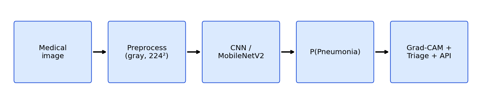

# 🩻 AI-Powered Medical Image Analysis

Deep-learning pipeline that classifies **chest X-rays as NORMAL or PNEUMONIA**, explains its
decisions with **Grad-CAM**, and simulates how such a model would **triage a radiologist's
worklist** in a hospital. Built with Python, OpenCV, TensorFlow/Keras and Flask on **public data**.

> ⚠️ **Educational project only - not a medical device and not for clinical use.**

  <!-- replace with your own screenshot, see docs/GITHUB_GUIDE.md -->

## Table of contents
Problem · Industry relevance · Features · Tech stack · Dataset · Architecture · Project structure ·
Installation · Usage · Results · Virtual simulation · Limitations · Learning outcomes

## Problem statement
Radiologists read huge numbers of images, and urgent cases can wait in the same queue as routine
ones. A decision-support model that flags suspicious studies can help prioritise reading and give
a consistent "second look". This project builds that workflow end-to-end: data → preprocessing →
CNN → evaluation → explainability → triage → API.

## Industry relevance
Commercial radiology-AI products (for example from Aidoc, Qure.ai, Annalise.ai, Lunit and the imaging
divisions of Siemens Healthineers, GE HealthCare and Philips) follow the same pattern:
classification/detection model → priority flag → radiologist review. This repo reproduces the core
engineering pattern at student scale, including the metrics that matter in healthcare
(sensitivity/recall, specificity, ROC-AUC) rather than accuracy alone.

## Features
- Two models: **custom CNN** (from scratch) and **MobileNetV2 transfer learning** (+ optional fine-tuning)
- Preprocessing inside the model (rescaling + safe augmentation), class-imbalance handling
- Evaluation: accuracy, precision, **sensitivity**, specificity, F1, ROC-AUC, confusion matrix, error gallery
- **Grad-CAM** heatmaps for explainability
- **Triage simulation** → prioritised worklist CSV (URGENT / REVIEW / ROUTINE)
- **Flask API + web page** for upload-and-predict
- **Synthetic data generator** so anyone can test the pipeline in minutes without downloading data
- Unit tests that run without TensorFlow

## Tech stack
Python 3.10-3.12 · TensorFlow/Keras · OpenCV · NumPy · scikit-learn · Matplotlib · Flask

## Dataset
[Chest X-Ray Images (Pneumonia)](https://www.kaggle.com/datasets/paultimothymooney/chest-xray-pneumonia)
(Kaggle, pediatric chest X-rays, labelled NORMAL / PNEUMONIA). Setup instructions: [`data/README.md`](data/README.md).
Please read the dataset's licence/terms on Kaggle before redistributing anything. Datasets are not committed to this repo.

## Architecture
```
Medical image (JPEG/PNG)
   │
   ▼
Load as grayscale ──► Resize 224×224 ──► (raw 0-255 pixels)
   │
   ▼  [inside the model]
Augmentation (train only) ► Rescaling ► Conv blocks (feature extraction) ► GAP ► Dropout ► Sigmoid
   │
   ▼
P(PNEUMONIA)  ──► threshold 0.5 ──► label
   │                    │
   ▼                    ▼
Grad-CAM heatmap     Triage priority ► worklist.csv        Flask API ► JSON
```
More detail: [`docs/ARCHITECTURE.md`](docs/ARCHITECTURE.md)

## Project structure
```
AI-Medical-Image-Analysis/
├── data/          dataset instructions (data itself is git-ignored)
├── notebooks/     Colab walkthrough
├── src/           config, data_loader, preprocessing, model, train, evaluate,
│                  predict, explain (Grad-CAM), triage, synthetic, visualize, metrics, app (Flask)
├── models/        saved .keras models (git-ignored)
├── outputs/       raw run outputs (git-ignored)
├── images/        curated screenshots/graphs shown in this README
├── docs/          architecture, simulation, GitHub & interview guides
├── tests/         smoke tests
├── main.py        command-line entry point
├── requirements.txt
└── .gitignore
```

## Installation
**Windows (PowerShell)**
```powershell
git clone https://github.com/<your-username>/AI-Medical-Image-Analysis.git
cd AI-Medical-Image-Analysis
python -m venv venv
venv\Scripts\activate
pip install -r requirements.txt
```
**macOS / Linux**
```bash
git clone https://github.com/<your-username>/AI-Medical-Image-Analysis.git
cd AI-Medical-Image-Analysis
python3 -m venv venv
source venv/bin/activate
pip install -r requirements.txt
```
No GPU? Use the CNN model on CPU, or run on free GPU via Google Colab (`notebooks/colab_walkthrough.ipynb`).

## Usage
```bash
# 0. (optional) test everything on synthetic data - add --dataset simulated to each command below
python main.py synthetic

# 1. Explore data + preprocessing
python main.py explore
python main.py preprocess

# 2. Train
python main.py train --model cnn --epochs 15
python main.py train --model mobilenet --epochs 8 --fine-tune-epochs 5     # better accuracy

# 3. Evaluate on the test set
python main.py evaluate --model-path models/cnn_best.keras

# 4. Predict one image + Grad-CAM (cnn model)
python main.py predict --model-path models/cnn_best.keras --image path/to/xray.jpeg --gradcam

# 5. Virtual-hospital triage simulation
python main.py triage --model-path models/cnn_best.keras --folder data/chest_xray/test

# 6. Web demo / API
python main.py serve --model-path models/cnn_best.keras      # http://127.0.0.1:5000
curl -F "image=@xray.jpeg" http://127.0.0.1:5000/predict
```
Run tests: `pytest -q`

## Results
> Fill this table **with your own numbers** after training (open `outputs/*_metrics.json`).
> Do not copy numbers from elsewhere.

| Model | Accuracy | Sensitivity (recall) | Specificity | F1 | ROC-AUC |
|---|---|---|---|---|---|
| Custom CNN | _your result_ | _your result_ | _your result_ | _your result_ | _your result_ |
| MobileNetV2 | _your result_ | _your result_ | _your result_ | _your result_ | _your result_ |

| Training curves | Confusion matrix |
|---|---|
|  |  |

| Predictions | Grad-CAM |
|---|---|
|  |  |

## Virtual simulation
Public datasets stand in for hospital data: each image is a "study", its folder label is the
"radiologist's report", and the model acts as decision support that re-orders the reading queue
(`python main.py triage`). See [`docs/SIMULATION.md`](docs/SIMULATION.md).

## Limitations & ethics
- Public pediatric dataset ≠ real-world hospital population; expect performance drops on new scanners/patients.
- Kaggle labels are not verified clinical ground truth; the test split is small and not patient-level guaranteed.
- A model can learn shortcuts (hospital markers, image artefacts). Grad-CAM helps spot this but does not prove correctness.
- Outputs are probabilities for decision support, never a diagnosis.

## Future work
External validation, multi-class (bacterial vs viral), DICOM support, calibration, Docker deployment, MONAI/PyTorch variant.

## Learning outcomes
Medical image preprocessing · CNNs & transfer learning · class imbalance · clinical metrics (sensitivity/specificity/AUC) ·
explainable AI (Grad-CAM) · building an inference API · reproducible, tested ML repo structure.

## Disclaimer
Educational use only. Not intended for diagnosis or treatment decisions.

## Author
Your Name · [LinkedIn](https://linkedin.com/in/your-profile) · [GitHub](https://github.com/your-username)
